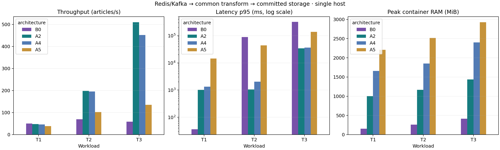

# Benchmark baseline B0 / A2 / A4 / A5 — kết quả chạy thật

Definition of Done (T1/T2 đủ cả bốn cấu hình): **đạt**.

## Phạm vi

Dữ liệu thật: 20.745 bài Silver từ 7 nguồn; 322 bài nhãn tai nạn, 35 chưa rõ, 20.388 bài khác. Các workload dùng cùng N bài đầu theo thứ tự thời gian/khóa. Đây không phải 20K vụ tai nạn.

Đo broker (Redis/Kafka) → parse → cùng transform Python/Polars → storage commit. Lọc/trích xuất đã tính trước; không chạy matching hoặc embedding trong phép đo. A4/A5 dùng foreachBatch chuyển batch về một driver để chạy cùng logic, không đo khả năng mở rộng matching phân tán.

**B0 = Redis + Python/Polars + DuckDB**: dùng trực tiếp ArticleQueue của src/streaming/queue.py (LPUSH, BRPOPLPUSH sang processing, Lua ACK sau commit), một consumer, một bài/transaction như consumer hiện hành. Chỉ payload/transform/schema dùng chung với benchmark; không chạy nguyên ArticleProcessor lọc/trích xuất/matching. A2 gom tối đa 512 bài/transaction, nên so sánh B0/A2 phản ánh cả broker và cách commit, không tách riêng tốc độ broker. Redis bật AOF everysec như compose chính; ACK không bảo đảm fsync từng message khi mất điện.

Một partition Kafka, Spark local[1], worker 2 CPU/5 GiB. Storage/checkpoint/snapshot trên volume Linux Docker, không ghi DB qua OneDrive. T1: 1K bài @50/s; T2: 10K @200/s; T3: 20K gửi nhanh nhất có thể. Thông số phần cứng và image thực tế trong environment.json. Ingestion không gồm tải package/khởi động Spark; lần microbatch/storage đầu tiên vẫn có chi phí khởi tạo. Đây là single-host benchmark.

## Median các lần chạy

| Kiến trúc | Tải | Lần | Thời gian (s) | Bài/s | p95 (ms) | RAM đỉnh (MiB) | CPU (%) | Query p95 (ms) | Xuất snapshot (s) |
|---|---|---:|---:|---:|---:|---:|---:|---:|---:|
| A2 | T1 | 3 | 20.83 | 48.02 | 1025.52 | 1004.51 | 61.78 | 1.00 | 0.00 |
| A2 | T2 | 3 | 50.49 | 198.06 | 1062.28 | 1166.81 | 111.23 | 1.28 | 0.00 |
| A2 | T3 | 1 | 39.22 | 509.97 | 34310.13 | 1435.30 | 127.00 | 2.12 | 0.00 |
| A4 | T1 | 3 | 21.51 | 46.49 | 1332.97 | 1659.51 | 109.53 | 0.84 | 0.00 |
| A4 | T2 | 3 | 51.20 | 195.31 | 2036.40 | 1849.44 | 144.25 | 3.81 | 0.00 |
| A4 | T3 | 1 | 44.28 | 451.67 | 36527.56 | 2399.91 | 143.87 | 5.24 | 0.00 |
| A5 | T1 | 3 | 25.73 | 38.87 | 14553.93 | 2208.00 | 203.77 | 1.56 | 1.38 |
| A5 | T2 | 3 | 97.44 | 102.63 | 43730.02 | 2514.44 | 194.20 | 1.84 | 0.96 |
| A5 | T3 | 1 | 147.71 | 135.40 | 137221.69 | 2926.52 | 180.02 | 4.19 | 1.26 |
| B0 | T1 | 3 | 20.00 | 50.01 | 36.29 | 151.97 | 70.89 | 1.15 | 0.00 |
| B0 | T2 | 3 | 143.85 | 69.52 | 89043.34 | 262.60 | 87.94 | 1.86 | 0.00 |
| B0 | T3 | 1 | 342.16 | 58.45 | 319582.85 | 414.26 | 87.54 | 6.70 | 0.00 |

Độ dao động min/max/std cho từng metric nằm trong summary.csv. T1/T2 bị giới hạn tốc độ producer; throughput gần 50/200 bài/s không phải trần năng lực hệ thống.

## Correctness và giới hạn

- 28/28 runs hợp lệ có đủ output, không mất/trùng bài và qua thử ghi lại batch đã commit.
- T1: 12 runs, deterministic output digest and all SQL answers agree.
- T2: 12 runs, deterministic output digest and all SQL answers agree.
- T3: 4 runs, deterministic output digest and all SQL answers agree.
- Latency dùng timestamp ngay trước send đến timestamp ngay sau commit trả về, cùng clock Linux. Không dùng processed_at để giả làm committed_at.
- Retry ở đây là phát lại cùng microbatch sau commit; chưa kiểm thử kill/restart tiến trình, mất broker hoặc mất điện. Không coi kết quả này là bằng chứng phục hồi production đầy đủ.
- RAM/CPU là tổng worker + broker đang dùng (Redis với B0, Kafka với A2/A4/A5) + PostgreSQL trong khoảng ingestion. PostgreSQL chạy idle ở B0/A2/A5 để giữ phạm vi đo phụ trợ như trước. Kafka không được cộng vào baseline Redis. CPU 100%=một core. RAM là working set lấy mẫu, không gồm overhead VM/Windows. Các run ngắn có ít mẫu hơn; xem resource_samples/logs.
- A5 ingestion dừng ở commit Delta. Xuất snapshot Parquet đo riêng; query DuckDB trên snapshot. Không gộp snapshot_export_s vào ingestion latency.
- Đầu ra là schema gọn có khóa bài, tiêu đề, hash nội dung và các trường đã định nghĩa; không lưu toàn văn. Kết quả storage/query không đại diện cho kho lưu toàn bộ thân bài hay full-text search.
- Các tập tải là prefix theo thời gian của cùng dataset, không phải mẫu cân bằng nguồn/tỉnh. T3 nếu chỉ có một lượt thì chưa đủ để ước lượng độ dao động; xem cột Lần trong bảng.
- Spark giới hạn 512 offset/trigger, trigger 1 giây; A2 flush ngay khi đủ 512 hoặc hết thời gian chờ 1 giây. T3 vì vậy có cả ảnh hưởng lịch microbatch/cấu hình giới hạn, không phải phép đo trần riêng của từng storage engine.
- Cùng ba SQL đếm bài theo nguồn, nhãn và tỉnh/ngày đăng; warm-up một lần, đo 15 lần/query. query_p95_ms là pooled p95; truy vấn theo event bị bỏ qua vì event_id chưa có nhãn đáng tin, không bịa số vụ.
- Các pilot trước khi chuẩn hóa volume và trước khi chuyển A2 sang ghi batch Arrow được lưu riêng trong pilot_*.csv, không đưa vào so sánh.
- Baseline Redis đệm commit ledger để tránh flush Windows bind mount sau từng bài. Các lượt Redis dùng log line-buffered được giữ trong pilot_b0_linebuffered.csv và loại khỏi bảng chính. Số đo Kafka cũ vẫn giữ nguyên; lượt A2 đối chứng với log đệm được báo cáo riêng nếu có, nhằm kiểm tra độ lệch giữa hai đợt đo.
- Lỗi phát triển và smoke thất bại vẫn có log trong results/logs; failed_count trong runs.csv là số bài lỗi của run đã hoàn thành, không phải tổng mọi lần khởi động thất bại trong lúc phát triển.

## Đề xuất

Trong phép đo chung hiện tại, **A2** có median throughput T2 cao nhất. Chỉ áp dụng cho cấu hình và workload trên; chưa đủ để kết luận kiến trúc nào thắng khi chạy matching thật hoặc scale-out. Nếu chênh lệch nhỏ giữa B0 và A2, cân nhắc giữ Redis đang có để giảm chi phí chuyển đổi; nếu cần Kafka thì A2 đơn giản hơn Spark. Chưa chứng minh được ngưỡng workload mà Spark bắt đầu có lợi.
B0 xử lý từng bài còn A2 gom batch, vì vậy chưa thể quy chênh lệch throughput cho Redis/Kafka. Nếu giữ stack hiện tại và cần tăng tải, nên thử gom batch/giảm số transaction trên Redis trước khi quyết định đổi broker. Đối chiếu cả độ trễ T1, không chỉ throughput T2/T3.

## A2 đối chứng cùng đợt baseline

Chạy thêm 1 lượt A2/T2 với commit ledger có đệm: **196.02 bài/giây**, p95 **1246.53 ms**. Digest đầu ra khớp T2 cũ; dữ liệu kiểm tra đầy đủ ở baseline_control.csv. Lượt đối chứng được giữ riêng, không trộn vào median ba lượt Kafka ban đầu.

### Trạng thái Redis và giới hạn RAM

Sau đo còn **4711 message pilot** ở namespace của lượt đã hủy, Redis báo khoảng **16.68 MiB** bộ nhớ key. Chúng không được tiêu thụ bởi các queue mới, không thuộc output của 7 lượt baseline. Số RAM baseline là working set quan sát thực tế, có cả phần tồn này; không trừ hậu nghiệm hoặc coi là footprint của một Redis sạch. Cần reset namespace pilot trước khi dùng phép đo lại để so RAM nghiêm ngặt. Chi tiết ở baseline_residual_queues.json.

## Matching Python đo riêng

Chạy 3 lần trên **322 bài nhãn tai nạn**, dùng pipeline canonical hiện có trên Windows host, median **5.826 giây**, **55.27 bài/giây**. Warm-up model/cache **48.837 giây** được ghi riêng, không cộng vào median.

Model: `sentence-transformers/paraphrase-multilingual-MiniLM-L12-v2`. Kết quả mỗi lần: 165 vụ mới, 9 bài ghép vào vụ có sẵn, 148 bài chờ review. Đây là kiểm tra kế toán và thời gian, không phải đánh giá độ chính xác matching.

Phép đo riêng này không có Kafka/Spark và không cùng workload/hệ điều hành với bảng A2/A4/A5. Không dùng nó để suy ra throughput matching của Spark hay cộng cơ học các throughput. Xem matching_python.csv và matching_python_manifest.json để biết cấu hình/model fingerprint.

## Biểu đồ

## Chạy lại và nguồn

Xem [README](../README.md) để dựng stack, chuẩn bị dữ liệu, chạy suite và xem giới hạn đo. Mọi run_id trong runs.csv có correctness.json, queries.json, commits.jsonl và metrics.json ở work/<run_id>/.

Tài liệu chính thức: [Kafka Docker](https://kafka.apache.org/39/getting-started/docker/), [Spark Kafka](https://spark.apache.org/docs/3.5.6/structured-streaming-kafka-integration.html), [Delta foreachBatch](https://docs.delta.io/delta-streaming/).
