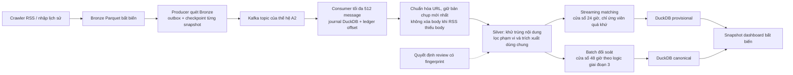

# Luồng chính A2: Kafka, Python/Polars và DuckDB

## Luồng thực tế



Producer chỉ đọc **Bronze**. Silver được tạo phía consumer; file review là metadata
quyết định phân loại, không phải nguồn bài được producer gửi. Review chỉ áp dụng
khi fingerprint nội dung/tiêu đề/mô tả/link/ngày đăng khớp; bài thay đổi được phân
loại lại, không ép dùng nhãn cũ.

Đây là xử lý nghiệp vụ thật: khử trùng TF-IDF, bộ lọc tai nạn, bộ trích xuất,
matching, embedding mặc định và tổng hợp sự kiện. Không dùng transform rút gọn
hoặc dữ liệu tổng hợp của benchmark.

## Streaming và batch khác nhau ở đâu?

| Phần | Streaming | Batch |
|---|---|---|
| Đầu vào bài | Bronze qua Kafka | Silver của cùng thế hệ, do consumer tạo |
| Làm sạch/lọc/trích xuất | Dùng chung `a2.processing`, có cache theo fingerprint và phiên bản | Tái sử dụng Silver đã xử lý; không chạy lại NLP trên bài không đổi |
| Matching | `MatchingService`, bán kính 24 giờ, `past_only=True` | `run_batch`, cấu hình giai đoạn 3, bán kính 48 giờ |
| Kho | `provisional.duckdb` | `canonical.duckdb` |
| Kích hoạt | Khi nhận bài mới/thay đổi | Kiểm tra theo lịch, xây lại khi revision thay đổi; có thể ép bằng `--once` |

Trong đợt backfill, consumer ghi journal theo các transaction nhỏ rồi dựng các
projection khi bắt kịp watermark Kafka, tránh dựng lại toàn bộ lịch sử sau mỗi lô.
Trong chế độ live, mỗi lô mới kích hoạt cập nhật Silver và projection streaming.
Batch dùng cùng Silver để đối soát toàn bộ. Projection được dựng vào file tạm,
đóng/checkpoint rồi thay thế file đích, nên cập nhật bài không để lại sự kiện cũ
do lần phân loại trước.

**Thời gian 24/48 giờ là cửa sổ tìm ứng viên matching, không phải lịch chạy.**
Các khoảng quét/gom lô không phải cam kết độ trễ end-to-end: NLP, khử trùng toàn
catalog và matching cần thêm thời gian; dịch vụ ghi rõ phase đang xử lý.

## Lịch mặc định

- Poll Kafka: tối đa 512 message, chờ tối đa một giây khi chưa có tin.
- Quét outbox Bronze: năm giây. Snapshot đã ACK và không đổi không được gửi lại.
- Crawl bảy RSS: năm phút; mỗi nguồn lỗi được ghi riêng, không làm mất snapshot đã lưu.
- Đối soát batch: 15 phút khi có revision mới. Chạy backfill/`--once` sẽ đối soát ngay.
- Dashboard: kiểm tra pointer snapshot mỗi 10 giây, cập nhật trạng thái dịch vụ định kỳ.
- Dữ liệu mới hơn batch được xem mặc định qua kho streaming; không cộng hai kho
  vì chúng có thể mô tả cùng vụ tai nạn.

Ví dụ đổi lịch:

```powershell
.venv/Scripts/python.exe -m main --crawl-seconds 300 --scan-seconds 5 --batch-seconds 900
```

## Chạy và dừng

```powershell
$env:PYTHONPATH='src'
$env:PYTHONUTF8='1'
docker compose up -d --wait kafka
.venv/Scripts/python.exe -m main
```

Đọc lại toàn bộ Bronze vào một thế hệ mới, crawl thêm một lượt, chạy cả hai kho
và publish dashboard rồi thoát:

```powershell
.venv/Scripts/python.exe -m main --rebuild --history --crawl-once --once
```

Không dùng `--rebuild` khi chỉ muốn tiếp tục sau khi dừng: chạy lại lệnh bình
thường sẽ dùng checkpoint cũ. Gửi yêu cầu dừng an toàn từ terminal khác:

```powershell
.venv/Scripts/python.exe -m main --stop
```

Một tiến trình giữ khóa writer của A2; không chạy hai dịch vụ trên cùng bộ dữ liệu.
`python -m streaming.run` cũng trỏ tới A2. Giao diện `enqueue_article(article)`
mặc định lưu Bronze hoàn chỉnh để outbox gửi Kafka. Redis chỉ còn là giao diện
legacy khi truyền client/queue Redis tường minh; không thuộc đường chạy chính.

`python -m main --step ...` giữ các lệnh bảo trì cũ, không phải đường chạy live A2.

## Lưu trữ, checkpoint và phục hồi

- Broker riêng từ `compose.yaml`: Kafka `127.0.0.1:29092`, named volume
  `a2-kafka-data`, chính sách restart `unless-stopped`. Không dùng Kafka/Redis
  của bộ benchmark.
- `data_artifacts/a2/current.json`: topic, consumer group và đường dẫn thế hệ đang dùng.
- `data_artifacts/a2/<run_id>/bronze_outbox.json`: SHA256, số dòng và ACK từng snapshot.
  Snapshot chỉ checkpoint sau khi các future gửi Kafka thành công. Gửi lại sau
  crash có thể tạo message mới nhưng không tạo thêm bài theo URL.
- `data/gold/a2/<run_id>/state.duckdb`: bài gốc chuẩn hóa, fingerprint, nguồn Bronze,
  ledger `(topic, partition, offset)` và revision các projection.
- `data/silver/a2/<run_id>/`: catalog, dấu trùng, classified và extraction từng nguồn.
- `data/gold/a2/<run_id>/provisional.duckdb`, `canonical.duckdb`: hai kho sự kiện thật.
- `data_artifacts/dashboard_current.json`: trỏ duy nhất tới snapshot đã publish;
  dashboard không đọc file DB đang được ghi.

Journal và ledger offset commit cùng transaction. Offset Kafka chỉ được ACK sau
khi Silver và projection streaming đã hoàn tất, đồng thời batch nếu đến lịch.
Nếu lỗi sau journal commit nhưng trước khi dựng xong projection, dữ liệu vẫn có
revision chờ xử lý; phát lại Kafka không nhân bản bài. Nếu lỗi sau khi file
projection hoàn tất nhưng trước ACK, projection có thể được dựng lại an toàn.
Fingerprint message giúp phát hiện offset bị tái dùng với payload khác; không
âm thầm coi dữ liệu mới là bản phát lại.

Payload không hợp lệ được lưu cùng lỗi trong `kafka_messages`, trạng thái
`quarantined`; lỗi xử lý/network/DB không bị biến thành ACK thành công. Offset hết
hạn không tự nhảy qua dữ liệu: cần khôi phục broker hoặc dùng `--rebuild` từ Bronze.

Chọn bản chụp mới nhất theo thời gian crawl/capture, không theo thứ tự duyệt file.
RSS không có body không được xóa body đã crawl. Body lịch sử có thể bổ sung cho
headline mới hơn mà không ghi đè headline đó.

## Theo dõi và các giới hạn

- `data_artifacts/a2/live_status.json`: PID, heartbeat, phase, revision và số message.
- `data_artifacts/a2/last_run.json`: thống kê lần chạy gần nhất.
- `data_artifacts/a2/first_history_and_crawl.json`: bằng chứng lượt backfill và crawl
  mới đầu tiên của đợt chuyển A2; các lần kiểm tra replay sau đó có báo cáo riêng.
- `data_artifacts/a2_full_run.log`, `a2_reconcile.log`: log chạy thật.

Nguồn RSS có thể chỉ có tiêu đề/mô tả; thân bài thiếu sẽ được đánh dấu, không suy
diễn thương vong bằng 0. Enrichment dateline VnExpress giữ cách xử lý hiện có.
Các bài cần xem xét không được tính tự động thành sự kiện chắc chắn.

Đây là triển khai một máy, một Kafka broker và writer được điều phối trong một
dịch vụ Python. Không tuyên bố chịu lỗi mất cả broker/máy hoặc exactly-once trong
mọi tình huống. Sau reboot cần khởi động dịch vụ Python lại; container Kafka có
restart policy nhưng không tự khởi động chương trình Python trên Windows.
