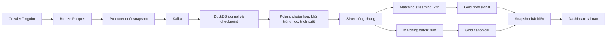

# Kết quả chuyển luồng chính sang A2

Ngày kiểm chứng: 18/11/2026. Backfill và lượt crawl mới hoàn thành tối 17/11; kiểm tra khôi phục sau restart sáng 18/11.

## Luồng chính

Producer đọc **Bronze**, không phát lại Silver. Bộ lọc, trích xuất và matching dùng logic nghiệp vụ thật, không dùng transform rút gọn của benchmark. Quyết định review chỉ áp dụng khi fingerprint nội dung khớp. Hai nhánh matching dùng chung Silver.

## Kết quả chạy thật

| Chỉ tiêu | Kết quả |
|---|---:|
| Bronze lịch sử | 247 snapshot / 22.480 dòng |
| Một lượt crawl mới, đủ 7 nguồn | 410 dòng |
| Tổng Bronze qua Kafka | 254 snapshot / 22.890 message |
| URL mới bổ sung | 294 |
| Bài cũ cập nhật nội dung | 1 |
| Bài duy nhất theo URL | 21.049 |
| Đánh dấu trùng nội dung | 12 |
| Giữ sau khử trùng | 21.037 |
| Bài tai nạn | 341 |
| Bài chưa rõ phạm vi | 35 |
| Bài ngoài phạm vi | 20.661 |
| Batch: sự kiện | 173 |
| Batch: bài đã gắn sự kiện | 183 |
| Batch: bài chờ review matching | 158 |
| Streaming: sự kiện tạm thời | 175 |
| Streaming: bài chờ review matching | 156 |

Dân Trí timeout lượt đầu; crawl lại riêng nguồn này thành công 100 dòng. Sáu nguồn còn lại có 310 dòng. Đây là 410 dòng RSS, không phải 410 URL mới.

341 là số **bài báo**, không phải số vụ. Không cộng hai kho event. Streaming và batch có cửa sổ, quy tắc online khác nhau nên số sự kiện có thể khác nhau. Bài chưa gắn sự kiện vẫn được giữ để review.

Bronze gốc và các thế hệ Silver/Gold cũ được giữ nguyên. Thế hệ hiện tại: `20261117-161621-8bf1ff6b`; kết quả trong `data/silver/a2/` và `data/gold/a2/`. Dashboard đọc `data_artifacts/dashboard_current.json`.

## Lịch hoạt động

- Consumer poll liên tục, chờ tối đa khoảng 1 giây; xử lý gom nhóm message.
- Producer quét Bronze mỗi 5 giây.
- Crawler định kỳ 300 giây; chạy ngoài vòng consumer.
- Batch kiểm tra mỗi 900 giây, tái tổng hợp khi revision đổi.
- Dashboard kiểm tra snapshot mới mỗi 10 giây.

24h/48h là **cửa sổ matching**, không phải chu kỳ chạy. Độ trễ còn phụ thuộc NLP/matching. Streaming tái dựng projection từ tập bài tai nạn hiện hành khi đầu vào đổi để loại bỏ kết quả cũ sai; không bảo đảm độ trễ toàn pipeline là 1 giây.

## Kiểm chứng

- Suite: 200 tests, OK; 5 Redis integration tests bỏ qua vì opt-in, không thuộc A2.
- Phát lại thật 22.890 message: 0 insert, 0 update, 0 quarantine; revision không đổi.
- SHA256 hai DB stream/batch không đổi sau replay; Kafka committed offset = target = 22.890.
- AppTest không có exception: batch hiển thị 173 vụ, streaming 175 vụ; caption xác nhận đủ 7/7 nguồn và 410 dòng.
- Dashboard health endpoint trả `ok`: http://127.0.0.1:8501.

Bằng chứng: `data_artifacts/a2_tests_final.log`, `data_artifacts/a2_final_replay.log`, `data_artifacts/a2/replay_verification.json`, `data_artifacts/a2_complete_sources.log`, `data_artifacts/a2/live_status.json`.

## Vận hành

Xem [hướng dẫn A2](a2_live_pipeline.md). Chạy `python -m main` với `PYTHONPATH=src`; `python -m main --stop` để dừng an toàn. Heartbeat: `data_artifacts/a2/live_status.json`. Log: `data_artifacts/a2/service_stdout.log`, `service_stderr.log`.

Đây là cấu hình một máy, một broker và một writer, chưa phải HA. Sau restart Windows cần mở Docker Desktop và khởi động lại Python/dashboard. RSS thiếu body vẫn thiếu bằng chứng; chưa có cơ sở khẳng định bộ lọc/trích xuất chính xác tuyệt đối.

