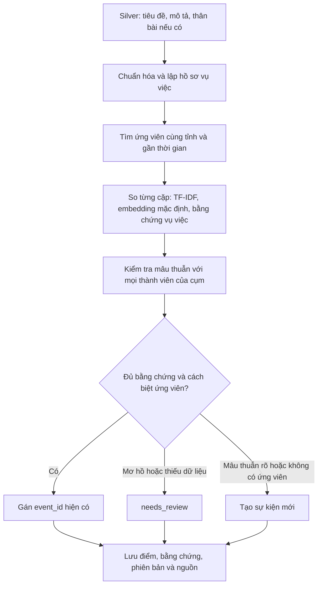

# Quy trình 3.2: nhận diện các bài cùng nói về một sự kiện

Bản triển khai: `hybrid-evidence-v2`. Mục tiêu là nhận diện cùng **vụ tai nạn cụ thể**, thay vì chỉ nhận diện cùng chủ đề giao thông. Chưa có tập nhãn độc lập được người kiểm duyệt xác nhận, nên các ngưỡng bên dưới là cấu hình khởi đầu, chưa phải mô hình xác suất đã hiệu chỉnh.

## Luồng xử lý đã triển khai



### 1. Đầu vào và chất lượng dữ liệu

- Chuẩn hóa HTML, Unicode NFC, khoảng trắng; giữ nguyên tiêu đề, mô tả và payload gốc để truy vết.
- Dùng thêm `content` hoặc `body` nếu Silver cung cấp. Không giả định RSS đã có toàn văn. Nội dung này được giữ trong payload và dùng lại khi đọc database.
- Thiếu tỉnh/ngày đăng/khóa bài hợp lệ vẫn vào hàng chờ. Không tự suy ra tỉnh từ bài khác chỉ để gộp.
- Các cờ nhiều vụ, giả định/phủ định vẫn chặn gán tự động.
- Cờ `missing_incident_details` được xét lại khi văn bản có dấu hiệu vụ việc cụ thể **và** địa danh có tên **và** phương tiện. Đây là cách xử lý một số cách diễn đạt mà extractor cũ bỏ sót; không bỏ qua cờ thiếu dữ liệu một cách tổng quát.

### 2. Hồ sơ vụ việc có bằng chứng

`src/events/profile.py` trích các dấu hiệu từ văn bản:

| Nhóm | Ví dụ | Cách dùng |
|---|---|---|
| Địa điểm cụ thể | tên đường, hầm, cầu, xã/phường | bằng chứng cùng vụ hoặc mâu thuẫn |
| Thời điểm xảy ra được nhắc rõ | “trưa 3/11”, “ngày 31/10” | tách khỏi ngày đăng; so ngày nếu có |
| Đối tượng | người đi bộ, thai phụ, học sinh, học viên tập lái | bằng chứng bổ trợ |
| Bối cảnh hiện trường | đường ven biển, hầm chui, đường ngang đường sắt | cần kết hợp đối tượng/phương tiện/tỉnh/thời gian |
| Định danh phương tiện | biển số, mã xe được nhắc | cần kết hợp bằng chứng khác |
| Phương tiện trích xuất | xe tải, xe máy, container | so tập phương tiện; thiếu dữ liệu không tính là trùng |

Không lấy tên báo, URL, nhãn mẫu hay danh sách vụ có sẵn làm đặc trưng phân loại. Không coi tên `quận Cầu Giấy` là tên một cây cầu, và bỏ địa danh trong ngữ cảnh quê quán/nơi cư trú/bệnh viện khi nhận ra được ngữ cảnh này.

Thời gian và địa danh vẫn được trích bằng luật, chưa phải bộ nhận diện thực thể/thời gian đã huấn luyện. Một bài có nhiều mốc ngày hoặc địa điểm sẽ cần kiểm duyệt; ngày được nhắc trong bản tin theo dõi đôi khi là ngày cơ quan chức năng thông báo, không phải ngày xảy ra. Đây là giới hạn cần kiểm tra khi gán nhãn.

### 3. Tìm ứng viên và tin theo dõi đăng muộn

- Cửa sổ thông thường của Phase 3 và batch: cùng tỉnh, ±48 giờ theo giờ đăng của bài đại diện. Streaming dùng 24 giờ quá khứ tới timestamp bài đang xử lý.
- Cửa sổ tin theo dõi: tối đa ±168 giờ, **chỉ nhận thêm ứng viên khi trùng ngày vụ việc được nhắc rõ và trùng địa điểm có tên, không có mâu thuẫn**.
- Khi hai bài trùng ngày xảy ra, thành phần thời gian không phạt chỉ vì giờ đăng cách xa nhau.
- Bài đăng muộn nhưng không nói rõ thời điểm/địa điểm không được tự nối vào vụ cũ.

API `retrieve_candidates()` của 3.1 vẫn giữ hợp đồng cửa sổ của nó; nhánh tìm tin theo dõi được triển khai ở repository. ID sự kiện và bài đại diện vẫn cố định, không kéo cửa sổ vô hạn qua chuỗi tin trung gian.

### 4. Biểu diễn văn bản và chấm điểm

Hai chế độ dùng chung toàn bộ kiểm tra bằng chứng:

- **Mặc định:** character TF-IDF + hồ sơ vụ việc + embedding `sentence-transformers/paraphrase-multilingual-MiniLM-L12-v2` qua FastEmbed/ONNX trên CPU. Không gọi API trả phí hay gửi nội dung bài báo ra ngoài; lần đầu cần tải trọng số mô hình, các lần sau dùng cache.
- **Tắt embedding tường minh:** dùng `--no-embedding` hoặc `MatchConfig(semantic_model=None)` để chỉ dùng TF-IDF + hồ sơ vụ việc. Thiếu thư viện/mô hình sẽ báo lỗi, không tự âm thầm đổi chế độ.

Điểm văn bản khi bật embedding:

```text
text = 0.65 × cosine_embedding + 0.35 × cosine_TF-IDF
```

| Thành phần | Trọng số |
|---|---:|
| Văn bản | 0.35 |
| Địa điểm chi tiết | 0.20 |
| Bằng chứng định danh vụ việc | 0.25 |
| Phương tiện | 0.10 |
| Thời gian | 0.10 |

Thuộc tính thiếu không được cho điểm 1; bỏ khỏi tổng trọng số khả dụng. Bằng chứng định danh đòi hỏi kết hợp các nhóm: địa điểm có tên + phương tiện + mốc thời gian; hoặc định danh xe + đối tượng/địa điểm + tỉnh/thời gian; hoặc đối tượng + bối cảnh cụ thể + phương tiện + tỉnh + thời gian gần nhau. Trùng tỉnh/ngày/loại xe đơn thuần chưa đủ cho nhánh diễn đạt khác nhau.

Tổng điểm là điểm heuristic, **không phải xác suất cùng sự kiện**. Cùng tên tuyến đường dài hoặc các địa điểm lồng nhau còn có thể gây nhầm; cần thêm dữ liệu toàn văn và nhãn khó để hiệu chỉnh.

Mô hình embedding khuyến nghị có giới hạn **128 input tokens** theo cấu hình FastEmbed. Repo chia văn bản thành các đoạn tối đa 120 tokens bằng API đếm token của encoder, embed từng đoạn rồi lấy trung bình có trọng số theo số token và chuẩn hóa vector. Nhờ đó không bỏ phần thân bài nằm sau giới hạn đầu vào. TF-IDF và hồ sơ cũng đọc văn bản đầy đủ. Cách tổng hợp đoạn này vẫn có thể bị nội dung nền làm loãng; cần đánh giá thêm cách chọn các câu mô tả vụ việc khi đã crawl được toàn văn dài.

### 5. Quyết định ở mức cụm

- Mâu thuẫn tỉnh/quận/xã, địa điểm có tên cùng loại hoặc ngày vụ việc rõ ràng được kiểm tra với **mọi thành viên**. Một thành viên gần giống không thể che mâu thuẫn với thành viên khác.
- Tính điểm theo từng cặp bài-thành viên; không ghép điểm văn bản của bài A với địa điểm của bài B để tạo một cặp giả có điểm cao.
- Chọn thành viên hỗ trợ tốt nhất, nhưng vẫn yêu cầu bài mới có quan hệ với bài đại diện để hạn chế gộp dây chuyền.
- Gán tự động khi điểm ≥0.75, trọng số khả dụng ≥0.70, có bằng chứng vụ việc và hơn ứng viên cạnh tranh ít nhất 0.10.
- Văn bản gần trùng cần cosine TF-IDF ≥0.85 cùng bằng chứng địa điểm hoặc phương tiện. Nhánh diễn đạt khác nhau chỉ được dùng ngưỡng văn bản thấp hơn khi có bằng chứng định danh vụ việc độc lập; không hạ ngưỡng để mọi tin tai nạn trở thành khớp.
- Mơ hồ/thiếu bằng chứng → `needs_review`; mâu thuẫn rõ hoặc không có ứng viên → `new_event`.
- Không dùng số thương vong làm khóa cứng: bài sau có thể cập nhật con số.

Lưu `lexical_score`, `semantic_score`, điểm từng thành phần, chi tiết hồ sơ, mâu thuẫn, thành viên hỗ trợ, khoảng cách với ứng viên cạnh tranh, phiên bản và fingerprint corpus/embedding để truy vết.

## Chạy trong repo

FastEmbed nằm trong dependency mặc định. Cài project và chạy bình thường:

```bash
.venv/bin/python -m pip install -e .
PYTHONPATH=src .venv/bin/python -m main --step=5
```

Lần đầu tải trọng số; những lần sau dùng cache trong `data/models/fastembed`. Có thể chỉ định vị trí cache bằng `--model-cache`. Chỉ cần `--semantic-model` khi muốn thay model mặc định.

Muốn chủ động tắt embedding:

```bash
PYTHONPATH=src .venv/bin/python -m main --step=5 --no-embedding
```

Các CLI `main`, `events.run`, `events.evaluate`, `batch.run` và `streaming.run` dùng chung mặc định và các tùy chọn này. Ví dụ tắt embedding cho batch hoặc Consumer:

```bash
PYTHONPATH=src .venv/bin/python -m batch.run --no-embedding
PYTHONPATH=src .venv/bin/python -m streaming.run --no-embedding
```

Liên kết đã lưu trong Gold vẫn được giữ nguyên khi chạy lại. Muốn đánh giá thuật toán mới, dùng database mới thay vì mong nó tự gộp lại các sự kiện cũ:

```bash
PYTHONPATH=src .venv/bin/python -m events.evaluate \
  --input-dir data/silver/accidents \
  --output-dir data/evaluation/events/my_new_run
```

`--output-dir` phải chưa tồn tại. CLI đánh giá chạy lại lần hai để kiểm tra tính ổn định và xác nhận SHA-256 đầu vào không đổi. Muốn đánh giá 7 nguồn đã chuẩn bị trong phiên làm việc này, thay input bằng `data/evaluation/event_matching/real_only_rvg3xi_5/articles`.

## Đánh giá và vòng phản hồi bắt buộc

1. Gán nhãn các bài thật theo event, kèm nguồn và người duyệt. Chọn cả cặp khó: cùng tỉnh/ngày/loại xe nhưng khác vụ; cùng vụ nhưng khác tiêu đề; cập nhật muộn; thiếu địa danh.
2. Chia tập theo **event**, không chia ngẫu nhiên từng cặp để tránh một vụ xuất hiện cả ở tập hiệu chỉnh và kiểm định.
3. Hiệu chỉnh ngưỡng trên tập phát triển theo yêu cầu precision/recall, khóa cấu hình rồi mới chạy tập kiểm định. Khi có đủ nhãn có thể thay bộ điểm heuristic bằng mô hình phân loại cặp được hiệu chỉnh xác suất.
4. Báo cáo precision, recall tính cả bài bị từ chối, tỷ lệ chờ, lỗi gộp nhầm, lỗi tách và retrieval recall. Cần bổ sung B-cubed khi có nhãn cụm đầy đủ; evaluator hiện tại chỉ tính chỉ số theo cặp được cung cấp.
5. Duyệt các bài `needs_review`, bổ sung nhãn độc lập và đánh giá lại. Không biến dự đoán của matcher thành nhãn chuẩn.

CLI nhận nhãn qua `--labels labels.json`:

```json
{
  "provenance": "Người duyệt, ngày duyệt, cách chọn mẫu và tập dữ liệu",
  "pairs": [
    {"left": "article_key_A", "right": "article_key_B", "same_event": true}
  ]
}
```

Nhãn dương chưa được gộp, kể cả chờ xem xét, được tính là FN để tránh tăng recall giả bằng cách loại bài khó khỏi mẫu.

## Kết quả trên dữ liệu thật đã có

Cùng đầu vào 30 bài được bộ lọc chọn từ 410 bài thật ở 7 nguồn:

| Cấu hình | Bài được nối vào sự kiện có sẵn | Bài chờ |
|---|---:|---:|
| Baseline v1 đã chạy trước thay đổi | 0 | 9 |
| v2 tắt embedding: bằng chứng + TF-IDF | 2 | 7 |
| v2 mặc định: bằng chứng + TF-IDF + embedding | 4 | 5 |

Bản có embedding gom được các cặp: hầm Phan Thúc Duyện; tai nạn đường Hồ Chí Minh ở Huế; container tông người đi bộ ở Nghệ An; tin theo dõi ô tô chèn ép thai phụ ở Lào Cai.

Đối chiếu bổ sung **14 cặp thật**: 6 cặp được nhận định cùng vụ và 8 cặp khác vụ. Bản semantic gộp 4/6 cặp dương, không gộp 8 cặp âm; còn 2 cặp dương liên quan bài thiếu tỉnh chưa xử lý được. Một cặp âm có bài chờ, nên không được tính là TN. Nhãn này do trợ lý đọc RSS và đánh dấu tạm, **chưa được người kiểm duyệt xác nhận, chưa phải tập kiểm định độc lập**, không dùng để tuyên bố độ chính xác chung.

Kết quả/điểm/database tại `data/evaluation/event_matching/v2_semantic_real_final/`. Đầu vào và Gold gốc giữ nguyên. Bài VietnamPlus về A Lưới đang bị bộ lọc trước 3.2 giữ ở `uncertain` nên vẫn chưa đến matcher; cải tiến 3.2 không tự sửa vấn đề ở bộ lọc.

## Cơ sở phương pháp

Thiết kế kết hợp văn bản, thực thể và thời gian phù hợp hướng nghiên cứu [Event-Driven News Stream Clustering using Entity-Aware Contextual Embeddings, EACL 2021](https://aclanthology.org/2021.eacl-main.198/). Repo này không triển khai mô hình được huấn luyện trong bài báo, và không kế thừa các chỉ số chất lượng của nghiên cứu đó. Backend CPU và mô hình đa ngôn ngữ tham khảo [FastEmbed Supported Models](https://qdrant.github.io/fastembed/examples/Supported_Models/).
