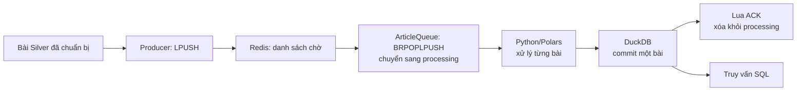
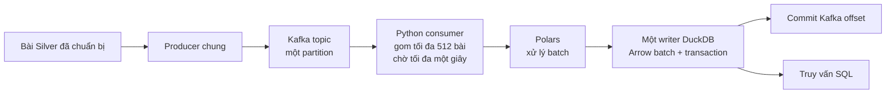
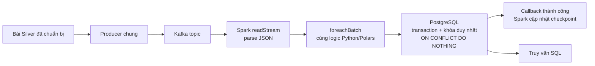
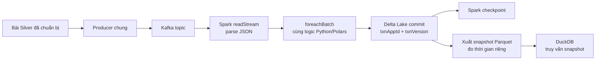

# So sánh bốn kiến trúc và lựa chọn cho News Big Data Platform

**Đề xuất:** Chọn **A2 — Kafka + Python/Polars + DuckDB** làm phương án triển khai tiếp theo trong bốn cấu hình đã đo.

Lựa chọn này phục vụ nhu cầu vừa tiếp nhận tin mới, vừa xử lý lại các đợt dữ liệu lịch sử khoảng 20.000 bài trên một máy và tiếp tục sử dụng logic Python hiện có. Đây là lựa chọn theo cấu hình/workload đã thử, **chưa phải kết luận Kafka luôn nhanh hơn Redis hay Python luôn nhanh hơn Spark**.

## 1. Bốn combo kiến trúc

| Mã | Broker | Xử lý | Lưu trữ và truy vấn | Cách ghi đã thử |
|---|---|---|---|---|
| **B0 — baseline** | Redis | Python/Polars | DuckDB | Một bài/transaction |
| **A2** | Kafka | Python/Polars | DuckDB | Gom tối đa 512 bài/transaction, một writer |
| **A4** | Kafka | Spark Structured Streaming; gọi cùng logic Python/Polars trong `foreachBatch` | PostgreSQL | Transaction theo micro-batch |
| **A5** | Kafka | Spark Structured Streaming; gọi cùng logic Python/Polars trong `foreachBatch` | Delta Lake; xuất snapshot Parquet cho DuckDB truy vấn | Commit Delta theo micro-batch |

Các sơ đồ dưới đây mô tả **luồng đã benchmark**. Đầu vào đã có nhãn lọc và các trường trích xuất tính trước; khối “xử lý chung” chỉ parse JSON, chuẩn hóa tiêu đề/nguồn, tính hash nội dung và tạo bản ghi đầu ra. Nó chưa chạy toàn bộ lọc tai nạn, trích xuất, embedding và matching.

### 1.1. B0: Redis + Python/Polars + DuckDB

- Dùng trực tiếp `ArticleQueue` của hệ thống hiện tại; chỉ ACK sau khi ghi DuckDB thành công.
- Bản tin chưa ACK còn trong `processing`, có thể đưa về hàng chờ để xử lý lại.
- Giữ cách xử lý/commit từng bài của consumer hiện hành. Redis bật AOF và `appendfsync everysec`.
- Đây là baseline **kiến trúc và cơ chế queue**, trên schema/workload chung. Nó dùng Redis Docker/Linux, không đo trực tiếp dịch vụ Memurai Windows hoặc toàn bộ `ArticleProcessor` hiện tại.

### 1.2. A2: Kafka + Python/Polars + DuckDB

- Tận dụng xử lý dữ liệu bằng Python/Polars; ghi cả batch bằng một câu SQL trong transaction.
- Chỉ commit offset sau khi DuckDB commit; khóa `(run_id, article_key)` chống ghi trùng khi phát lại.
- Giảm số transaction so với B0, đổi lại có thời gian chờ gom batch.

### 1.3. A4: Kafka + Spark Structured Streaming + PostgreSQL

- Spark điều phối các micro-batch; phần xử lý chung chạy trong callback Python tại driver.
- Mỗi lượt có checkpoint riêng; ghi lại cùng khóa không tạo thêm bản ghi.
- Thử nghiệm dùng `local[1]`, **chưa chạy xử lý phân tán hoặc distributed matching**. Kết quả không chứng minh giới hạn của Spark khi mở rộng nhiều máy.

### 1.4. A5: Kafka + Spark Structured Streaming + Delta Lake + DuckDB

- Điểm kết thúc ingestion là lúc Delta commit thành công.
- Sau ingestion mới xuất snapshot cho DuckDB. Thời gian xuất snapshot và thời gian truy vấn không được gộp vào latency ingestion.
- Cùng batch ID được phát lại không được append thêm lần nữa. Chưa kiểm chứng mọi tình huống lỗi hạ tầng.

## 2. Cách tổ chức benchmark

### Dữ liệu và môi trường

- Dataset gốc: **20.745 bài thật từ bảy nguồn**, gồm 322 bài nhãn tai nạn, 35 chưa rõ phạm vi và 20.388 bài khác. Không gọi đây là 20.745 vụ tai nạn.
- Các workload lấy cùng N bài đầu, cùng thứ tự thời gian/khóa bài; có manifest SHA256 để kiểm tra đầu vào không đổi. Các prefix không phải mẫu cân bằng nguồn/tỉnh.
- Cùng transform và schema đầu ra gọn; lưu tiêu đề, hash nội dung và các trường đã định nghĩa, không lưu toàn bộ thân bài.
- Worker giới hạn **hai CPU, 5 GiB RAM**; Spark `local[1]`. Redis/Kafka cùng giới hạn hai CPU và `mem_limit: 1500m`. DB, Delta và checkpoint nằm trên volume Linux Docker.
- Khởi động Spark/tải package nằm ngoài thời gian ingestion. Chi phí micro-batch/storage đầu tiên vẫn nằm trong phép đo.

| Tải | Số bài | Tốc độ producer | Lần chạy mỗi cấu hình | Mục đích |
|---|---:|---|---:|---|
| T1 | 1.000 | 50 bài/giây | 3 | Độ trễ ở mức gửi thấp hơn |
| T2 | 10.000 | 200 bài/giây | 3 | Khả năng theo kịp đầu vào và tài nguyên |
| T3 | 20.000 | Gửi nhanh nhất có thể | 1 | Hàng đợi và thời gian xử lý hết tải |

Bảng chính có **28 lượt**: bốn cấu hình, mỗi cấu hình ba lượt T1, ba lượt T2 và một lượt T3; cụ thể là `4 × (3 + 3 + 1) = 28`. Có thêm một lượt A2/T2 đối chứng lưu riêng.

### Các chỉ số

- **Throughput:** số bài duy nhất commit thành công / thời gian từ lần gửi đầu đến commit cuối.
- **Latency p50/p95:** từ ngay trước khi producer gửi bài đến ngay sau khi storage commit trả về. Ví dụ p95 một giây nghĩa là khoảng 95% bài có latency không vượt mốc đó trong lượt đo.
- **Thời gian tổng, thời gian drain:** đo cả quá trình và phần xử lý còn lại sau lần gửi cuối.
- **RAM đỉnh, CPU trung bình:** lấy mẫu các container trong khoảng ingestion; CPU 100% tương ứng một core.
- **Correctness:** kiểm tra số lượng, khóa, bài mất/trùng, digest nội dung và kết quả truy vấn.
- **Query p95:** cùng ba SQL đếm bài theo nguồn, nhãn và tỉnh/ngày đăng; warm-up một lần rồi đo 15 lần/query. Chưa dùng truy vấn đếm/top sự kiện do workload không có `event_id` đáng tin.

## 3. Kết quả đo

T1/T2 là **median của ba lượt**; T3 chỉ có một lượt. Độ trễ trong bảng dưới đổi sang giây cho dễ đọc.

| Cấu hình | T1: bài/s | T1: p95 (giây) | T2: bài/s | T2: p95 (giây) | T3: thời gian 20K (giây) | T3: bài/s |
|---|---:|---:|---:|---:|---:|---:|
| **B0 — Redis/Polars/DuckDB** | 50,01 | **0,036** | 69,52 | 89,04 | 342,16 | 58,45 |
| **A2 — Kafka/Polars/DuckDB** | 48,02 | 1,026 | **198,06** | **1,062** | **39,22** | **509,97** |
| **A4 — Kafka/Spark/PostgreSQL** | 46,49 | 1,333 | 195,31 | 2,036 | 44,28 | 451,67 |
| **A5 — Kafka/Spark/Delta/DuckDB** | 38,87 | 14,554 | 102,63 | 43,73 | 147,71 | 135,40 |

T1/T2 bị giới hạn tốc độ gửi, nên throughput gần 50/200 bài/s không phải bằng chứng đã đo được trần năng lực của hệ thống.

### Tài nguyên và truy vấn ở T2

| Cấu hình | RAM đỉnh quan sát (MiB) | CPU trung bình (%) | Query p95 (ms) |
|---|---:|---:|---:|
| B0 | 262,60 | 87,94 | 1,86 |
| A2 | 1.166,81 | 111,23 | 1,28 |
| A4 | 1.849,44 | 144,25 | 3,81 |
| A5 | 2.514,44 | 194,20 | 1,84 |

Đây là tổng **worker + broker đang dùng + PostgreSQL**; PostgreSQL chạy idle với B0/A2/A5. RAM là working set lấy mẫu, không phải dung lượng máy bắt buộc hoặc peak liên tục chính xác. Redis còn khoảng **16,68 MiB key memory của namespace pilot đã hủy**, có trong số đo RAM nhưng không được tiêu thụ vào các lượt chính. Vì vậy không coi B0 là phép đo Redis sạch và không dùng chênh lệch RAM nhỏ để xếp hạng chắc chắn. Chi tiết nằm trong báo cáo gốc.

Với A5, xuất snapshot tốn thêm median **0,96 giây ở T2**, **1,26 giây ở T3**, nằm ngoài thời gian ingestion trên. Query của A5 chạy trên snapshot Parquet đã xuất, không phải trực tiếp trên Delta đang ghi.

### Đối chiếu đầu ra và matching

- **28/28 lượt trong bảng chính** đủ đầu ra, không mất/trùng bài; digest và các kết quả SQL khớp giữa các cấu hình trên cùng workload.
- Đã kiểm tra ghi lại batch sau commit. Với Redis, có kiểm thử đóng consumer sau commit nhưng trước ACK, phục hồi queue và xử lý lại mà không tạo thêm dòng.
- Log Redis được đệm để tránh flush thư mục Windows sau mỗi bài. A2/T2 đối chứng với log đệm đạt **196,02 bài/s**, p95 **1,247 giây**, gần kết quả Kafka ban đầu; lượt này giữ riêng khỏi median ba lượt cũ.
- Matching Python hiện có được đo riêng ba lần trên **322 bài**: median **5,826 giây**, warm-up model/cache **48,837 giây** ghi riêng. Các lượt có cùng kết quả 165 vụ mới, chín bài ghép và 148 bài chờ review. Đây là kế toán đầu ra, không phải chứng nhận độ chính xác matching.

## 4. Phân tích từng phương án

### B0: phù hợp tin mới tải nhẹ, hạn chế khi nạp dồn lịch sử

B0 theo kịp 50 bài/s ở T1 và có p95 khoảng 36 ms, tốt nhất trong phép đo tải này. Nó không phải chờ gom batch, phù hợp khi muốn phản hồi từng tin sớm. Ở T2, producer gửi 200 bài/s nhưng đầu ra chỉ khoảng 69,5 bài/s; hàng đợi tích lại và p95 lên khoảng 89 giây. Với T3, xử lý hết 20K bài mất khoảng 342 giây.

**Không thể kết luận Redis là nguyên nhân chính gây chậm.** B0 thực hiện 10.000 transaction cho T2, trong khi A2 gom nhiều bài trong một transaction; cả cách chạy Polars và số lần ACK/ghi cũng khác. Muốn so riêng broker phải thử Redis theo batch với cùng chính sách ghi như A2. Nếu chỉ cần tải tin mới nhỏ và muốn tránh chi phí chuyển đổi, giữ Redis vẫn là phương án hợp lý.

### A2: cân bằng nhất cho workload hiện tại

A2 gần theo kịp mức gửi 200 bài/s, p95 khoảng một giây ở T2. T3 hoàn tất 20K bài trong 39,22 giây, nhanh nhất trong bốn cấu hình đã đo. Nó giữ hướng xử lý Python/Polars và writer DuckDB, phù hợp để tái sử dụng các phần nghiệp vụ hiện có.

Chi phí cần chấp nhận là vận hành thêm Kafka thay Redis và thời gian chờ gom batch: p95 T1 khoảng một giây, kém B0 ở tải nhẹ. Adapter A2 trong benchmark chưa phải bản thay thế production hoàn chỉnh; vẫn cần tích hợp nghiệp vụ và kiểm thử phục hồi trước khi chuyển luồng chính.

### A4: kết quả gần A2 nhưng chưa có lợi ích đủ rõ trên một máy

Throughput T2 của A4 khoảng 195,3 bài/s, gần A2 khoảng 198,1 bài/s. Tuy nhiên p95 cao hơn, tài nguyên quan sát lớn hơn, và phải triển khai cả Spark lẫn PostgreSQL. T3 cũng chưa nhanh hơn A2.

Vì Spark chạy `local[1]` và callback đưa batch về Python driver, phép đo **chưa khai thác xử lý phân tán**. A4 đáng đánh giá lại nếu yêu cầu sau này buộc phải xử lý nhiều máy hoặc cần kiểm chứng khả năng phục vụ nhiều ứng dụng truy cập storage đồng thời; các lợi ích đó chưa được đo trong đợt này.

### A5: thêm nhiều bước mà workload này chưa chứng minh được lợi ích

A5 đạt khoảng 102,6 bài/s ở T2 và 135,4 bài/s ở T3, p95 cao, đồng thời cần xuất snapshot trước khi DuckDB truy vấn. Đối với bài toán hiện tại, đợt đo chưa cho thấy lợi ích bù được chi phí Spark/Delta và bước snapshot.

Không kết luận Delta Lake luôn chậm. Đợt thử chỉ là một cấu hình micro-batch trên một máy, chưa đo bài toán lakehouse hoặc xử lý dữ liệu phân tán lớn mà một kiến trúc khác có thể cần.

## 5. Lựa chọn: A2 — Kafka + Python/Polars + DuckDB

### Lý do chọn

1. **Phục vụ cả tin mới và nạp lại dữ liệu lịch sử.** A2 vừa gần theo kịp 200 bài/s ở T2, vừa xử lý xong 20K bài nhanh nhất trong các cấu hình đã thử. Đây là nhu cầu thực tế của dự án sau khi bổ sung dữ liệu lịch sử.
2. **Giữ phần lớn hướng triển khai Python hiện tại.** Có thể tiếp tục sử dụng logic lọc, trích xuất và matching, thay vì đưa thêm Spark vào đường xử lý chính khi chưa có bằng chứng cần thiết.
3. **Hiệu năng gần hoặc tốt hơn A4 trong phép đo, ít thành phần xử lý hơn.** A2 không cần thêm Spark và PostgreSQL như A4; kết quả hiện tại chưa cho thấy đổi sang A4 giúp giải quyết workload tốt hơn.
4. **Không cần bước xuất snapshot từ Delta như A5 trong luồng đo này.** DuckDB là nơi commit và truy vấn, giảm số bước cần tổ chức so với A5.
5. **Có quy tắc commit/ACK rõ và đã kiểm tra idempotency cơ bản.** DB commit trước offset commit; phát lại cùng bài không ghi thêm dòng. Đây là nền để kiểm thử phục hồi tiếp, không phải khẳng định đã bảo đảm exactly-once khi gặp mọi lỗi.

**Quyết định này chọn cả combo và cách xử lý batch đã thử, không chứng minh riêng việc thay Redis bằng Kafka tạo ra mức tăng tốc.** Trước một cuộc chuyển đổi production tốn công, nên đo thêm Redis gom batch cùng cấu hình A2 để xác định phần lợi ích đến từ giảm số transaction. Nếu Redis batch đạt yêu cầu tương đương và không có nhu cầu riêng về Kafka, giữ Redis có thể tiết kiệm công chuyển đổi hơn.
## Trạng thái triển khai — 18/11/2026

A2 đã được chọn và triển khai làm luồng chính tại máy này, chạy lại toàn bộ Bronze và một lượt tin mới từ 7 nguồn. Số đo benchmark trong tài liệu là phép đo riêng, không phải số đo NLP production. Xem [kết quả chuyển đổi](a2_migration_result.md) và [hướng dẫn A2](a2_live_pipeline.md).

